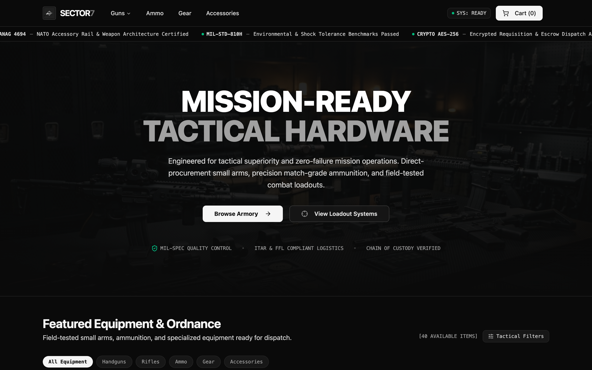
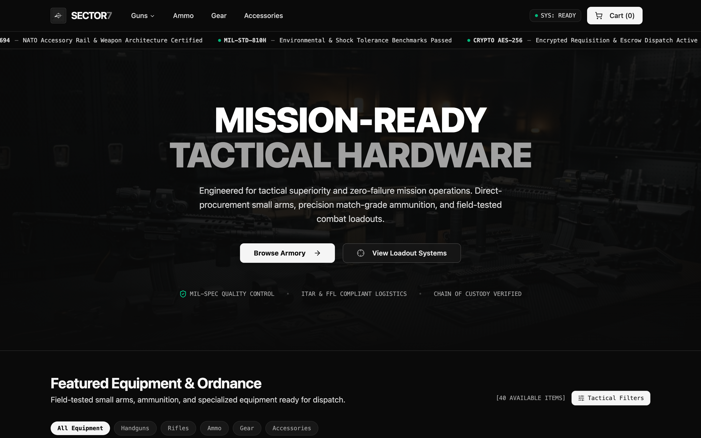
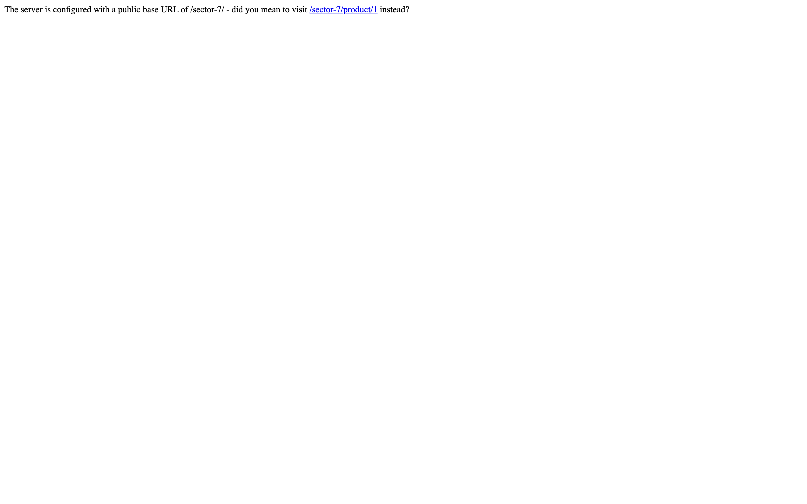
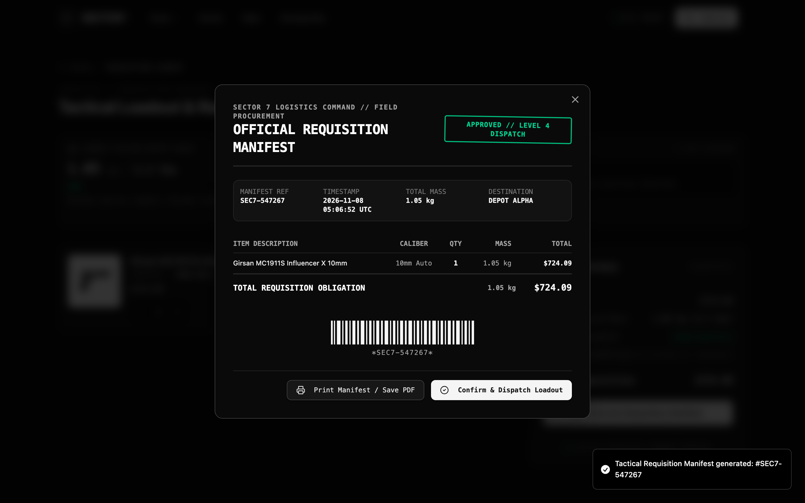
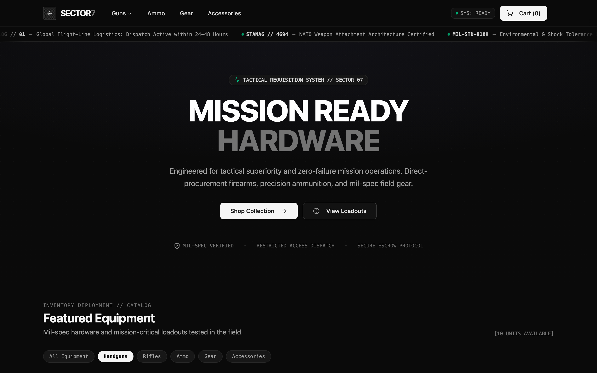
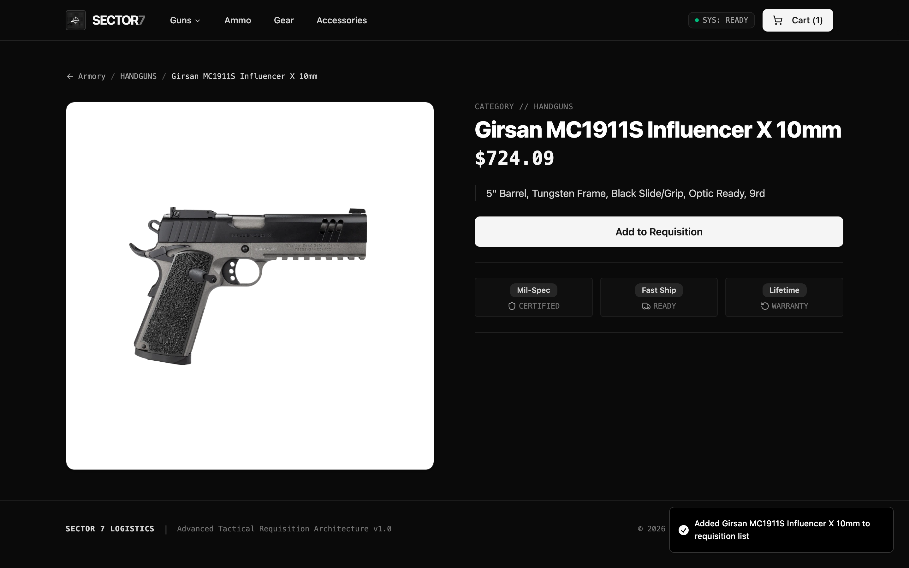
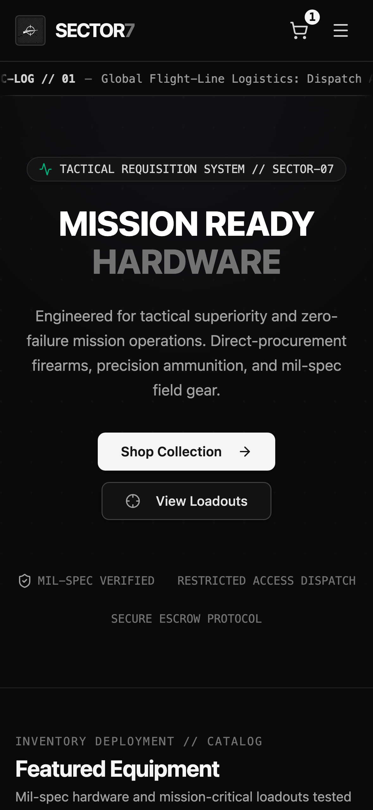
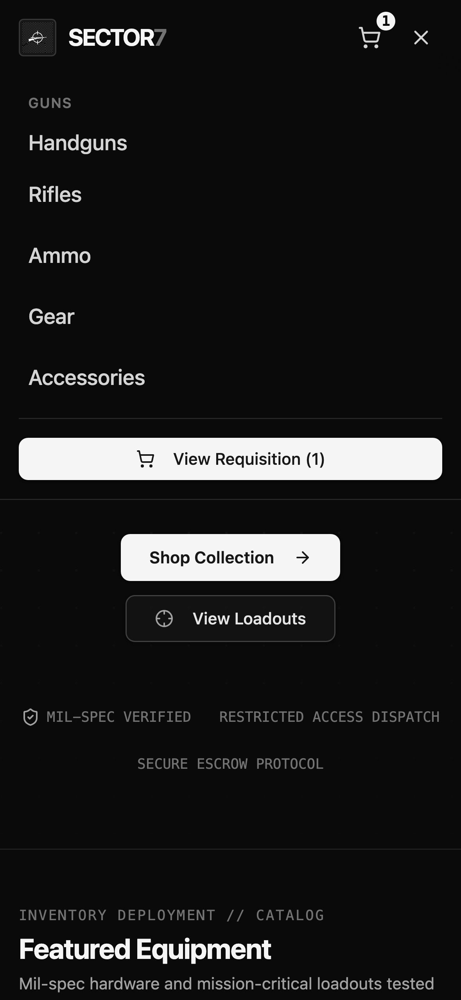
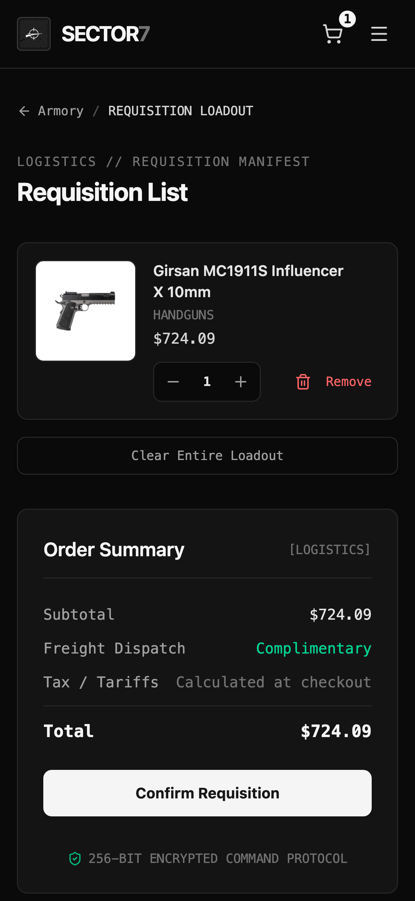
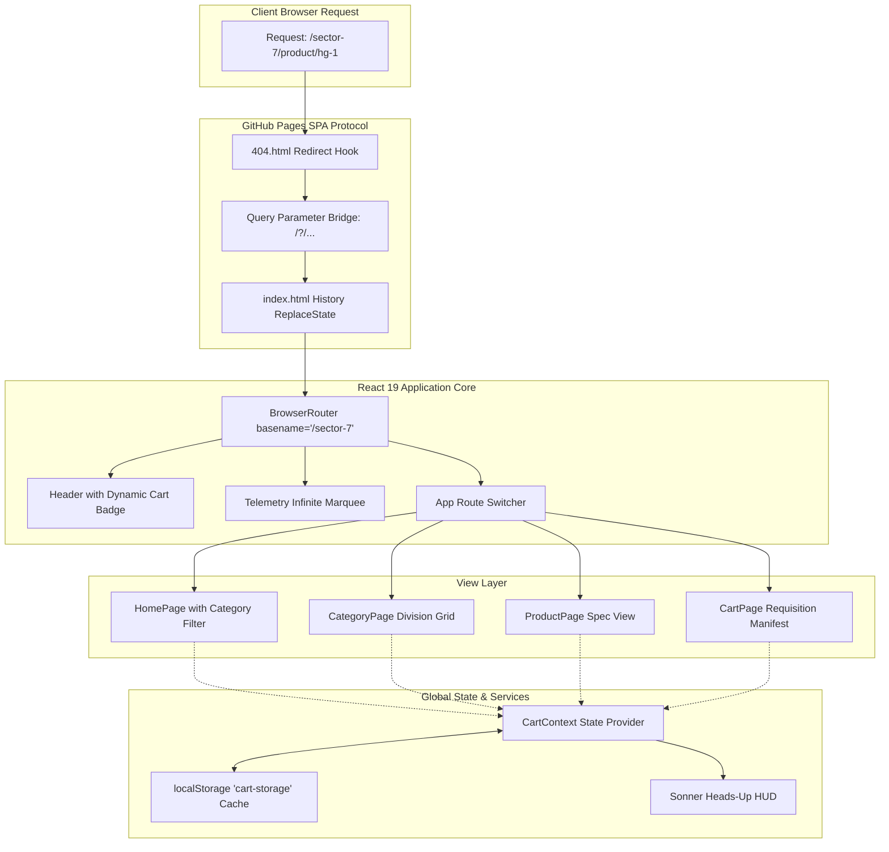

# Sector 7 Logistics
## Advanced Tactical Requisitions & Defense Procurement Architecture

<div align="center">
  
  <br />
  <h3><i>"Equipping the Elite. Defining the Standard."</i></h3>
  <p>Mil-spec tactical e-commerce platform engineered with React 19, TypeScript, Tailwind CSS v4, and Vite.</p>
  
  <p>
    <a href="https://github.com/kanishk-upadhyay/sector-7/actions">
      
    </a>
    <a href="https://react.dev/">
      
    </a>
    <a href="https://vitejs.dev/">
      
    </a>
    <a href="https://tailwindcss.com/">
      
    </a>
    <a href="https://www.typescriptlang.org/">
      
    </a>
    <a href="LICENSE">
      
    </a>
  </p>

  <p>
    <b>Live Deployments:</b>
    <a href="https://kanishk-upadhyay.github.io/sector-7/"><b>GitHub Pages Production Mirror</b></a> •
    <a href="https://kanishk-sector7.surge.sh/"><b>Surge Standby Edge</b></a>
  </p>
</div>

---

## 🖥️ Visual Interface Overview

### Desktop Command Center (1440 × 900)


### Tactical Innovations & Advanced Logistics
| Multi-Faceted Armory Filter Drawer | Technical Blueprint HUD Mode |
| :---: | :---: |
|  |  |

| Tactical Loadout Weight & Caliber Gauge | Printable Requisition Manifest Modal |
| :---: | :---: |
|  |  |

### Requisition Workflow & Spec Views
| Interactive Category Filter | Requisition Heads-Up Feedback |
| :---: | :---: |
|  |  |

---

## 📱 Mobile Field Terminal Emulation (Pixel 7 / iPhone 14 Pro: 393 × 852)

| Mobile Armory Feed | Touch Navigation Drawer | Mobile Cart Manifest |
| :---: | :---: | :---: |
|  |  |  |

---

## 🛡️ Mission Brief

**Sector 7 Logistics** is a next-generation tactical e-commerce platform designed for defense contractors, specialized law enforcement, and field operators requiring high-grade requisitions.

Built with a "function-over-form" philosophy that yields a brutalist, tactile aesthetic, Sector 7 unifies mil-spec visual design with modern web performance: zero layout shifts, instantaneous client-side filtering, touch-optimized stepper controls, and clean SPA deep-linking on GitHub Pages.

---

## ⚡ Core Architectural Capabilities

### 1. The Armory (Dynamic Real-Time Catalog)
* **Instant Filter Pills**: Filter across Handguns, Rifles, Ammunition, Gear, and Accessories with zero latency and automatic unit count telemetry.
* **Persistent Breadcrumb Navigation**: Seamless hierarchical navigation (`Armory / Category / Unit`) across all product and category views.
* **Infinite Telemetry Marquee**: 35-second looping tactical telemetry ticker with edge gradient masks and auto-pause on user hover.

### 2. Tactical Requisition Management
* **Persistent Local Cache**: Requisition loadouts are synchronized to `localStorage` (`cart-storage`), persisting through browser reloads and connection drops.
* **Non-Intrusive Heads-Up Feedback**: Instant notifications via `Sonner` confirm inventory operations with reference order IDs.
* **Touch-Friendly Stepper**: Ergonomic $32\text{px}+$ touch targets on quantity controls with full ARIA accessibility attributes.

### 3. Clean SPA GitHub Pages Architecture
* **Clean History Routing**: Migrated from legacy `HashRouter` (`/#/category/handguns`) to clean HTML5 `BrowserRouter` (`/sector-7/category/handguns`).
* **SPA Redirect Bridge**: Integrated `spa-github-pages` protocol (`public/404.html` and `index.html` query decoder) ensuring deep links and browser reloads never 404 on static hosting.

### 4. Impeccable UI Craftsmanship
* **Strict Accessible Typography**: $12\text{px}$ minimum text floor (`text-xs` / `text-sm`), WCAG AAA high-contrast neutrals on deep charcoal surfaces (`#0a0a0a`), and `text-pretty` copy formatting to prevent awkward single-word line orphans.
* **Direct Mobile Header Access**: Dedicated header cart badge action visible on all viewport widths without requiring drawer expansion.

---

## 🏗️ Architecture & Component Topology



---

## 🛠️ Tech Stack & Engineering Standards

| Dimension | Technology | Specification / Standard |
| :--- | :--- | :--- |
| **Framework** | [React 19](https://react.dev/) | React 19.2 + TypeScript Strict Mode |
| **Bundler** | [Vite 7](https://vitejs.dev/) | Sub-second HMR and optimized production trees |
| **Styling** | [Tailwind CSS v4](https://tailwindcss.com/) | Atomic engine with CSS variables and custom keyframe animations |
| **UI Primitives** | [Radix UI](https://www.radix-ui.com/) | Headless, accessible navigation and component primitives |
| **Icons** | [Lucide React](https://lucide.dev/) | Precision vector tactical iconography |
| **Notifications** | [Sonner](https://sonner.emilkowal.ski/) | Non-blocking dark-themed heads-up display |
| **Routing** | [React Router v7](https://reactrouter.com/) | HTML5 History API routing with GitHub Pages SPA redirect support |
| **Deployment** | [GitHub Actions](https://github.com/features/actions) | Automated production build and deployment to GitHub Pages |

---

## 🚀 Local Development Setup

To inspect and test Sector 7 Logistics on your local workstation:

### 1. Clone the Repository
```bash
git clone https://github.com/kanishk-upadhyay/sector-7.git
cd sector-7
```

### 2. Install Dependencies
```bash
npm install
```

### 3. Launch Development Server
```bash
npm run dev
```

### 4. Build for Production
```bash
npm run build
```

### 5. Preview Production Build
```bash
npm run preview
```

---

## 📄 License & Attribution

Distributed under the **MIT License**. See [`LICENSE`](LICENSE) for complete terms.

```
Copyright (c) 2026 Kanishk Upadhyay
All tactical trademarks and mockup imagery are the property of their respective owners.
```

<div align="center">
  <p><b>Sector 7 Defense Logistics</b> • <i>Authorized Command Personnel Only</i></p>
</div>
